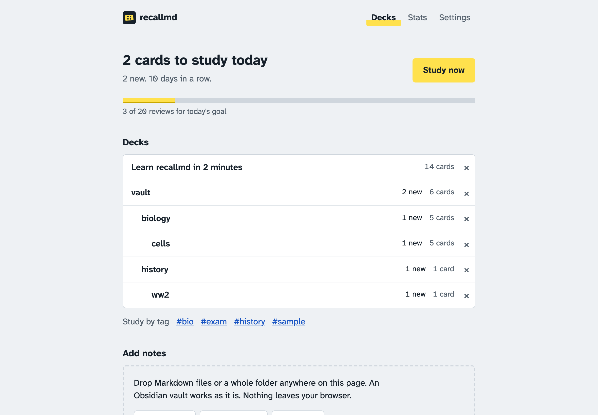
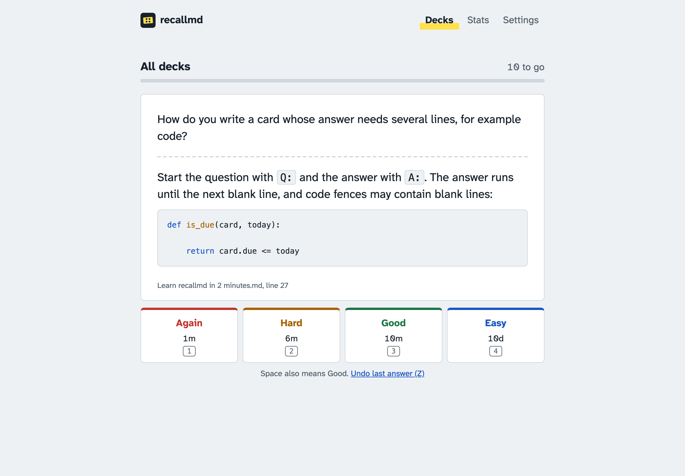
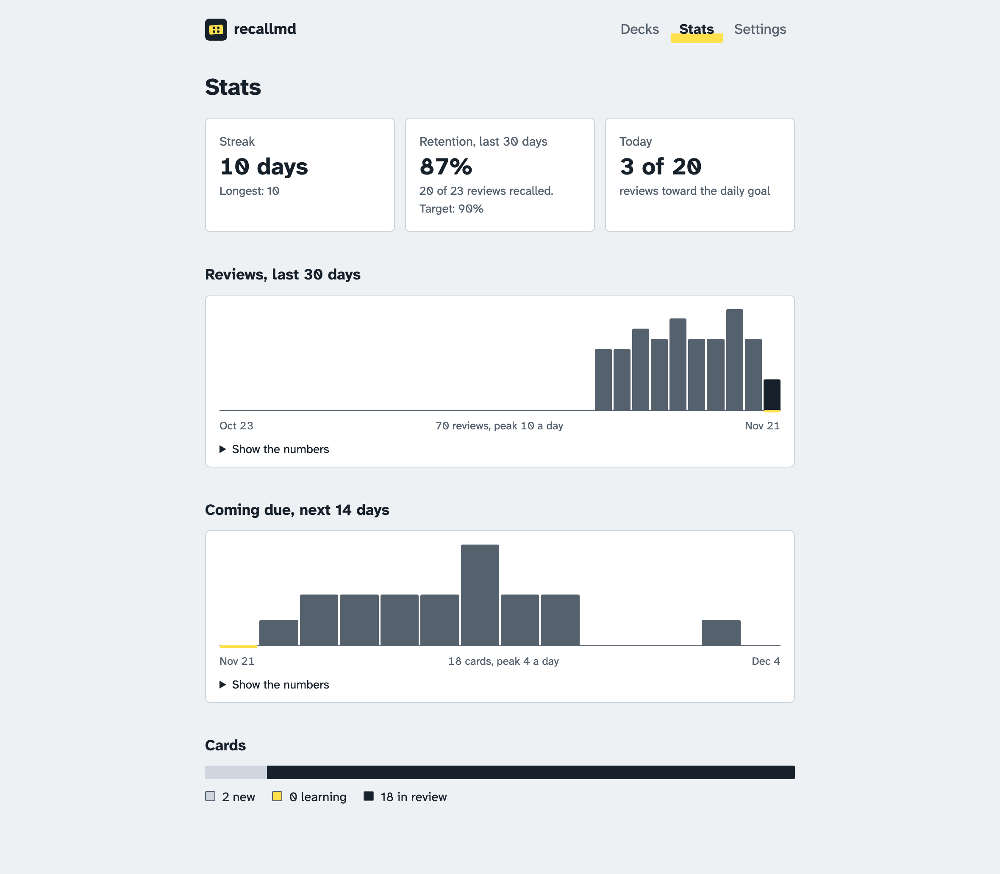
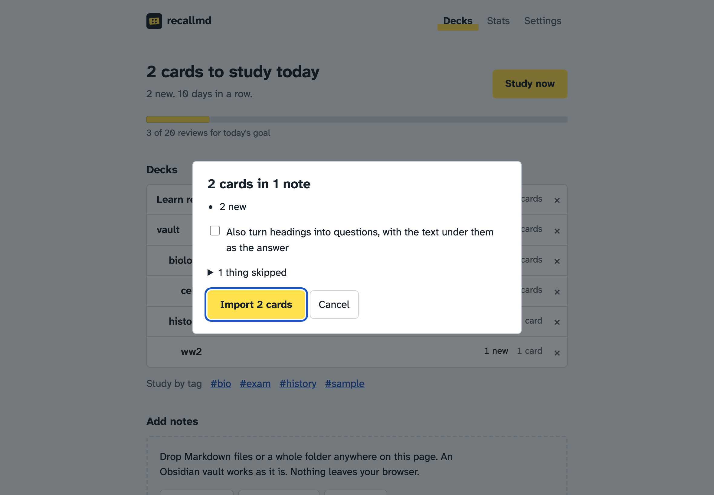
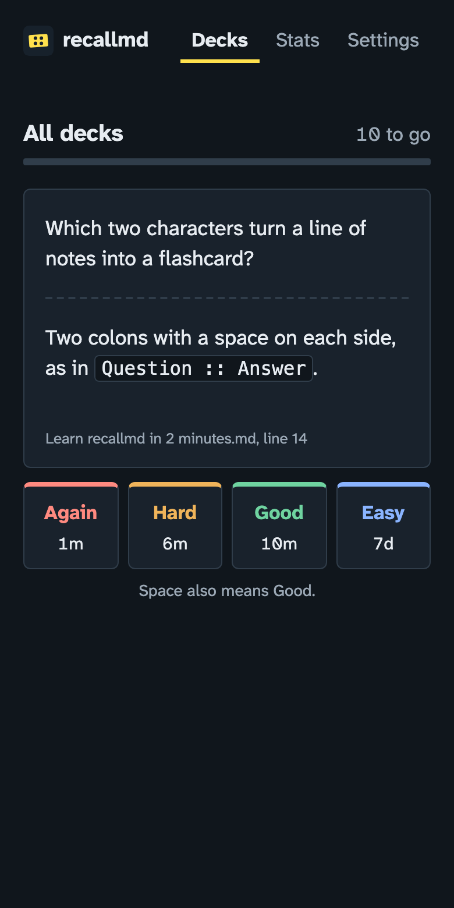

# recallmd

Turn the Markdown notes you already have into spaced-repetition flashcards, in the browser.
Drop in files or a whole Obsidian vault, review with the keyboard, and let FSRS decide when you see each card again. No account, no server: everything stays in your browser and works offline.



## Quickstart

You need Node.js 22 (20.19 or newer also works) and npm.

```sh
git clone https://github.com/Habibeyilmazz/recallmd.git
cd recallmd
npm install
npm run dev
```

Open <http://localhost:4130>. The first run starts with a 14-card sample deck, "Learn recallmd in 2 minutes", so you can try a review straight away.

To run the production build, which is the one with the service worker and offline support:

```sh
npm run build
npm run preview   # http://localhost:4131
```

`dist/` is a plain static site with relative paths, so it can be hosted anywhere, at any sub-path.

## Writing cards

Cards are ordinary lines in your notes. Nothing else in the note is touched.

````markdown
---
deck: Biology/Cells
tags: [bio, exam]
---

What is the powerhouse of the cell? :: The mitochondrion
- What do ribosomes make? :: Proteins

Plant cells have a ==cell wall== made of ==cellulose==.

Q: What does this print?
A: `3`, because the list has three items:
```python
print(len([1, 2, 3]))
```
````

| Syntax | Card |
| --- | --- |
| `Question :: Answer` | One-line card. The `::` needs a space on each side, so `std::vector` is left alone. Works in list items too. |
| `==highlight==` | Cloze deletion. Each highlight in a paragraph or list item becomes its own card with that part hidden. |
| `Q:` … `A:` | Multi-line card. The answer runs to the next blank line; code fences inside it may contain blank lines. |
| `## Heading` + text | Optional (tick "turn headings into questions" in the import preview). The heading path is the question and the section text is the answer. |

Card syntax inside code fences, inline code, inline math and one-line HTML comments is ignored. Answers and questions are rendered as Markdown, with syntax-highlighted code and KaTeX math (`$inline$` and `$$block$$`).

**Decks** come from the note's path (`Vault/biology/cells.md` becomes the deck `Vault/biology/cells`, nested under `Vault` and `Vault/biology`), or from a `deck:` line in the front matter. **Tags** come from front matter `tags:` and inline `#tags`, and you can study by tag.

## Features

- **Import** by dropping `.md`, `.markdown` or `.txt` files or a whole folder anywhere on the page, by picking files or a folder, or by pasting text. Dot-folders such as `.obsidian` are skipped. A preview shows what will be added, changed and removed before anything is written.
- **Progress survives edits.** A card's identity is a hash of its question, not its file, position or answer. Fix an answer, move or rename the note, and the card keeps its schedule. If you reword a question but keep its answer, re-importing matches the old card to the new one by similarity and carries the progress over. (Change both and it is treated as a new card.)
- **FSRS scheduling** (via [ts-fsrs](https://github.com/open-spaced-repetition/ts-fsrs)) with Again / Hard / Good / Easy. Each button shows when the card would come back. Desired retention is adjustable (70–97%).
- **Keyboard-first review.** `Space` or `Enter` shows the answer, `1`–`4` rate it, `Space` again means Good, `Z` undoes the last answer, `Esc` goes back to the decks.
- **Daily goal, streak and stats**: reviews per day for the last 30 days, cards coming due over the next 14, true retention, and how many cards are new, learning and in review.
- **Offline PWA.** After the first visit to a production build the app, fonts, KaTeX and the code highlighter are all cached; it can be installed and used without a connection.
- **Your data is yours.** Cards, schedule and history are stored in IndexedDB in your browser. Settings → Export progress writes one JSON file; importing it on another browser or device restores everything.
- Light and dark themes following the system setting, and a layout that works on a phone.



| Stats | Import preview | Phone, dark |
| --- | --- | --- |
|  |  |  |

The screenshots are taken from the running app by `scripts/screenshots.mjs`, which imports the test vault in `e2e/fixtures/` and studies it over ten simulated days.

## How it works

- `src/lib/parser.ts` walks a note line by line and returns cards. It is a pure function with no DOM, and has the bulk of the unit tests.
- `src/lib/importer.ts` compares the parsed cards with what is stored and produces an import plan: cards to write, cards that disappeared from a re-imported note, and progress to move from a removed card to its reworded replacement (same answer, and a Dice similarity of at least 0.6 between the questions' character bigrams).
- `src/lib/scheduler.ts` wraps ts-fsrs and builds the day's queue: cards in a learning step first, then reviews due before local midnight, then new cards up to the daily allowance. A card answered Again comes back in the same session.
- `src/lib/stats.ts` computes streak, retention, forecast and deck counts from the review log.
- `src/lib/db.ts` stores cards, FSRS state, the review log and settings in IndexedDB. Removing a deck keeps its progress, so importing the same notes later restores it.
- `src/lib/markdown.ts` renders card Markdown with marked, sanitizes the HTML with DOMPurify, and loads KaTeX and highlight.js only when a card needs them. Production builds also ship a Content-Security-Policy that forbids inline and remote scripts.
- `src/views/` holds the four screens (Decks, Review, Stats, Settings). There is no router or state library: hash routes and one React hook (`src/store.ts`).

## Development

```sh
npm run typecheck   # tsc
npm test            # unit tests (Vitest): parser, importer, scheduler, stats, storage, backups
npm run build
npm run e2e         # Playwright against the production build; run `npm run build` first
```

The end-to-end tests need Chromium once: `npx playwright install chromium`.

CI runs all four on every push. `.github/workflows/deploy.yml` builds and publishes to GitHub Pages, but only when you start it by hand from the Actions tab, and only after Pages has been set to "GitHub Actions" in the repository settings.

## Limits worth knowing

- There is no sync. Data lives in one browser profile; use Export progress to back it up or move it.
- The browser cannot watch your files. After editing notes, import them again (the preview shows what changed).
- Only text is imported. Local images and Obsidian `![[embeds]]` are shown as a name, not the file. Images linked by `http(s)` URL are loaded from their server when the card is shown.
- Picking or dropping a folder depends on browser support; on most phones you can only pick files or paste text.
- The automated browser tests run in Chromium only.
- A day ends at local midnight, and FSRS runs with its default parameters.

## Roadmap

- Re-sync a folder in one click with the File System Access API
- Import attachments so local images show up
- Reversed cards and the other Obsidian Spaced Repetition separators (`:::`, `?`, `??`)
- A card browser with search, and suspending cards
- Merging a backup into existing data instead of replacing it
- Optimizing FSRS parameters from your own review history

## License

[MIT](LICENSE) © Habibeyilmazz
